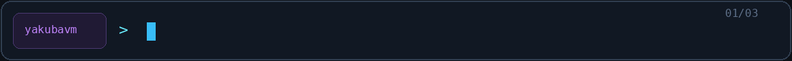
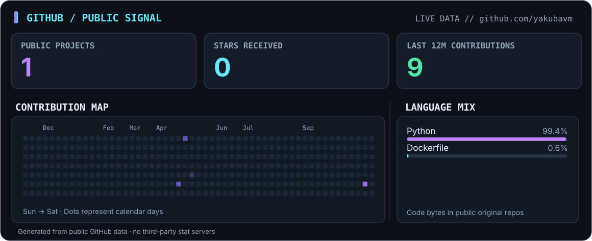

<!--
  YAKUBAVM / PROFILE
  Custom self-hosted visuals. No trackers, no third-party stat-card services.
  Edit text in this file; visual source files are located in /assets.
-->

  

   

  

   
   

  <a href="https://github.com/yakubavm?tab=repositories"><b>Explore projects</b></a>
  &nbsp; · &nbsp;
  <a href="https://github.com/yakubavm/discord_scheduler_bot"><b>Featured work</b></a>
  &nbsp; · &nbsp;
  <a href="mailto:yakubavm@proton.me"><b>Get in touch</b></a>

 

### `01 / identity`

I build **Python software, backend services, automations, scripts, and bots** — from the first prototype to reproducible deployment. I care about straightforward architecture, maintainable code, and tools that make everyday work more reliable.

### `02 / toolbox`

### `03 / environment`

### `04 / what I build`

### `05 / selected work`

**[Discord Scheduler Bot](https://github.com/yakubavm/discord_scheduler_bot)** — a Python/asyncio bot for scheduled Discord messages, with multi-channel delivery, attachment handling, queue management, and multilingual interaction. Packaged for both native and Docker-based deployment.

[Browse all public repositories](https://github.com/yakubavm?tab=repositories) for more code and experiments.

### `06 / public activity`

Activity is generated from GitHub's API in this repository — no third-party image service. Language proportions describe public source-code bytes, not skill levels. Private repository contents are never displayed.

 
 

  

  Built and maintained by <a href="https://github.com/yakubavm">@yakubavm</a> · Ukraine · <a href="mailto:yakubavm@proton.me">yakubavm@proton.me</a>

